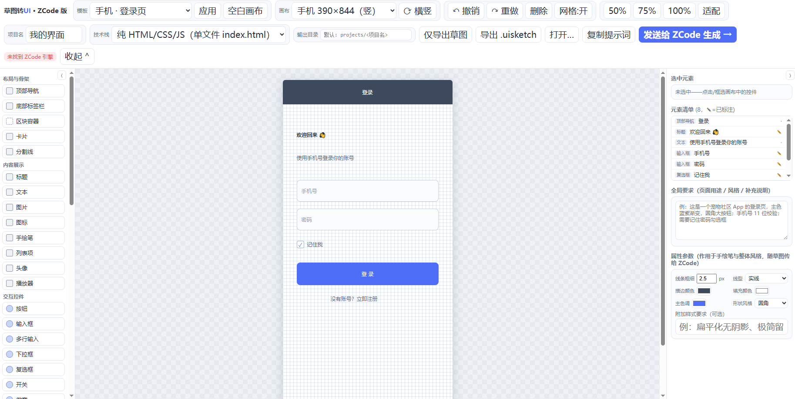
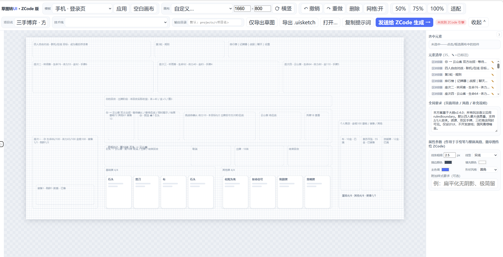
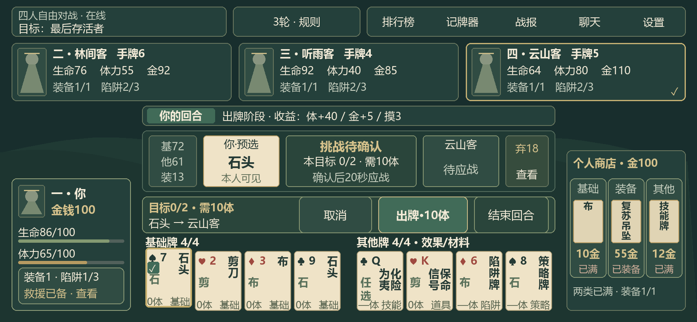
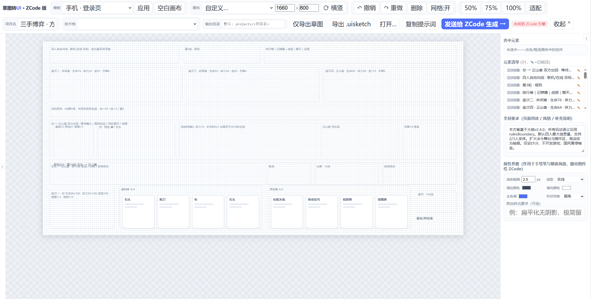
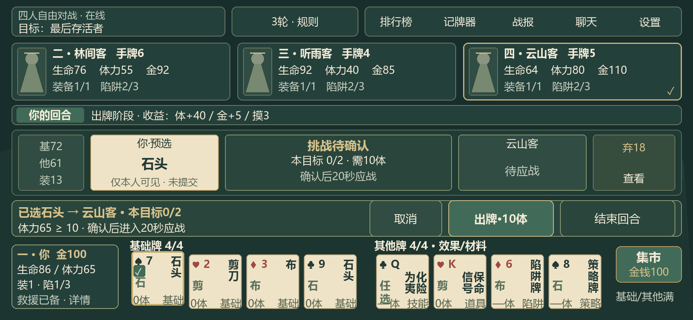

# 🐋 史上最好用的 UI 草图生成神器 · 史上最强的开源 UI 插件 · 史上最便捷的游戏界面构建工具

**Sketch2UI · ZCode 版** —— 一个把「脑子里的界面」直接变成可运行 UI 的本地画布工作台。拖组件、写备注、点一下，AI 拿到的不是一张需要猜的截图，而是一份**坐标、类型、用途、样式全部说得清清楚楚的工程级需求**。专治「AI 会写代码，但没人会设计界面」。

> 别的工具把截图丢给视觉模型，赌它猜得对；
> 这个工具把界面"拆开"交给 AI，每一块都在说人话。

/>

## 为什么会有这个工具（作者自述）

这个工具是我在用 AI 制作游戏时做出来的。因为本人对 UI 设计的水平实在拙劣，急需一个能好好做 UI 设计、并且能管理游戏界面布局与开发的工具。但我和 AI 翻了一圈，出奇地没找到好用的——市面上大多是「截图识别 → 转代码」，没有一个能让人先安安静静把界面「排」出来。

于是我干脆用 AI 做了这个类画布的工具来辅助开发游戏。它的用法类似 Godot 的模块化设计：把各种 UI 组件拖放、调整、搭配，并写上备注说明；AI 会直接读取生成的文件，理解我想要的是什么样的界面和 UI 布局。从某种角度说，它挺好用，也确实帮我调整、优化了 UI 设计。

但说实话，作者在代码水平和 UI 设计上的知识实在浅薄，这个工具在很多方面仍有很大的改进空间。

## 它到底强在哪

- **不靠猜。** 草图导出的是 `sketch.json`（元素精确坐标/类型/文字）× `sketch.png`（视觉参考）× `REQUIREMENTS.md`（需求清单）三件套，AI 拿到的是结构化真相，不是一张模糊的位图。市面上的同类几乎清一色"整图给视觉模型猜"，这是它最硬的差异化。
- **像 Godot 一样搭界面。** 左侧控件库（导航栏、标签栏、卡片、表格、图表、输入框、按钮……）点一下或拖进画布，组合、层级、对齐、缩放、框选全部顺手；右键拖动平移、滚轮缩放、8px 网格吸附，手感对齐正经设计软件。
- **每个组件都会"说话"。** 选中任意元素，在右侧写「用途与要求」：*点击校验手机号，为空时抖动提示*、*这里放实时排行榜，前三名高亮*。AI 会把这些备注逐条落实，而不是生成一个"看起来像"的空壳。
- **手绘笔 + 手绘标注。** 画布上可以直接徒手画线、画框、画箭头，笔画作为独立元素随草图导出，AI 会结合位置理解语义；线条粗细、实线/虚线/点线、描边色、填充色、主色调、圆角风格全部可调，并写进「全局样式参数」，生成时必须逐项遵守。
- **五种技术栈，说换就换。** 纯 HTML / Vue 3 / React / 微信小程序 / Flutter，同一份草图随时换目标栈重生成。
- **生成完还能自己挑错。** 勾选「自动比对返修」，ZCode 会对照草图与生成页截图自查偏差并返修——这套「生成 → 截图 → 比对 → 修正」的闭环，正是让同类顶流项目封神的那一环。
- **单文件规格，发进对话就能用。** 一键导出 `.uisketch`：布局、元素、标注、样式参数、手绘笔画、字段字典全部内嵌在一个文件里，丢进任意 ZCode 对话，AI 读文本就懂，不需要截图、不需要描述。
- **图片也能反着来。** 「选择图片解析…」把界面截图或手绘照片丢给视觉模型，直接解析成可编辑的画布元素，再走标注与生成流程。
- **模板化起步。** 登录页 / 内容列表 / 设置表单 / 后台仪表盘 / 官网落地页 / 空白画布，六个起点 + 自定义宽高 + 横竖一键互换。
- **全本地、零依赖、不联网偷数据。** Node ≥ 18 直接跑，不需要 npm install；草图、标注、生成结果全部留在你自己的 `projects/` 目录里。

## 为什么把它传上来

1. **给一个思路和方向的借鉴。** 随着 AI 的发展，游戏开发或网页制作里「代码」可能逐渐不再是问题，反倒是依赖人的审美的 UI 和界面，成了限制产品升级的主要因素。而目前还没有一个（至少我没搜到，信息来源也太少）合适的工具或插件，能帮用户做预布局和便捷设计。
2. **抛砖引玉。** 我个人水平有限，但觉得这个插件本身是个很有潜力的工具，希望别人能在这个基础上迭代升级，做出更好的 UI 设计工具；甚至不需要我的插件，自行独立设计也完全没问题。无论如何，希望有能力的大佬能往这个方向投入一些精力，帮帮像我这样的开发者——因为大家的游戏 UI 和布局，实在太丑了。
3. **以此为噱头，求个推荐。** 想请大佬们告诉我一声：还有哪些工具能替代这个小工具的作用？我实在找不到相关产品。**邮箱：hszy100@outlook.com**，知道的友友和大佬私信我一声；觉得这个想法不错，鼓励一下也可以。

## 现在已经能做什么

1. **模板化导出**：做好的 UI 布局可以导出成模板文件，以文件形式发给 AI，AI 读取后生成符合要求的界面；
2. **直连 ZCode**：与 ZCode 连接，直接把草图发给对话生成；
3. **拖放式组件**：大量 UI 组件可拖动、摆放、调整。

功能还不完善，坦白说离「好用」仍有距离。

## 我设想的升级方向

1. **更精准、细致的组件设计**：我没有 UI 设计知识，组件都是 AI 自己做的，很多组件在界面设计上是否专业、是否正确，我并不确定；
2. **作为插件接入 Agent 工具**（Codex / ZCode / WorkBuddy 等）：AI 可以把用户产品中的每个页面以组件形式呈现，用户实时调整后返回给 AI 继续修改——让用户随时看到 AI 做出来的界面长什么样，并能快速改；
3. **更便捷的布局与绘制**：组件放置、调整更顺手，配合自带参数调颜色/大小，像 PPT 和流程图那样快速上手，备注里补充组件要实现的功能与效果；
4. **模板生态**：用户做好后可导出模板上传到网页，其他人搜索、下载，再改成自己需要的样子发给 AI；
5. **场景化**：从单页拓展到全游戏场景设计，场景之间用按钮和提示词关联，AI 一次读取生成完整 UI 布局，用户也能自行调整场景切换逻辑与效果；
6. **接入生图模型 / Agent**：在工具内直接接入 AI 生成的素材并替换，或导入用户自己的素材；布局调好后由 AI 写代码。

以上是我对这个工具可能的方向和策略。希望看到的大佬们，有能力的话帮忙做这样一个插件——这些设想里很多功能，我实在无能为力。**拜托啦。**

## 草图 → 成品：它长什么样

上排是画布里的草图（组件 + 坐标 + 逐元素备注），下排是 AI 读完后生成的成品界面：

| 草图（画布内，含逐元素标注） | 生成成品 |
|---|---|
|  |  |
|  |  |

> 示例来自《三手博弈》的两版界面方案（A 环桌常驻型、B 宽幅决斗型）：同一份草图文件交给 ZCode，产出可直接运行的界面代码。

## 快速开始

1. 双击 `启动.bat`（或命令行运行 `node server.js`），浏览器会自动打开编辑器；
   - 若页面显示「服务未连接」：确认地址与黑窗口打印的一致（本机 localhost/127.0.0.1 回环异常，须用局域网地址）；
   - 若想让服务在后台常驻（关掉窗口也活着），可用 PowerShell 脱离进程树启动：
     `Start-Process node.exe server.js -WorkingDirectory <本目录> -WindowStyle Hidden`，日志看 `server.log`。
2. 选一个初始模板（登录页 / 内容列表 / 设置表单 / 后台仪表盘 / 官网落地页 / **空白页**），或直接点 **「空白画布」** 从零开始；
3. 画布尺寸：预设含手机/平板的**横竖屏**两向，支持**自定义宽高**（选「自定义…」输入），随时点 **「⟳ 横竖」** 互换宽高；顶部导航/底部标签栏会自动跟随新宽度；
4. 左侧控件库、右侧检查器边缘的 **⟨ ⟩** 小按钮可收起/展开面板（底部日志区用「收起 ⌄」），画布区最大化；
5. 从左侧控件库把控件**点击或拖入**画布，摆出你想要的布局；控件库里的**「手绘笔」**点击后进入笔模式（再点一次或按 Esc 退出），可在画布上徒手画线条/框/箭头——笔画会作为独立元素随草图一起导出，ZCode 会结合位置理解其语义；
6. 右侧**「属性参数」**栏（全局要求下方）设置线条粗细、线型（实线/虚线/点线）、描边色、填充色、主色调、形状风格（直角/圆角/大圆角/胶囊）与附加样式要求——手绘笔实时按参数渲染，且参数会作为「全局样式参数」一节写入 REQUIREMENTS.md，**ZCode 生成时必须逐项遵守**；
4. 选中任意控件，在右侧填写：
   - **文字 / 占位** —— 控件上显示的字；
   - **用途与要求** —— 这个控件要干什么（例：*点击校验手机号格式，为空时抖动提示*）；
   - 底部还有**全局要求**（页面用途、风格、整体行为）；
5. 选择技术栈（纯 HTML / Vue 3 / React / 微信小程序 / Flutter），点 **「发送给 ZCode 生成」**；
6. 底部控制台实时显示 ZCode 的运行日志与生成结果，完成后自动打开**生成预览**（内嵌 iframe），可以在右侧输入反馈点「发送修正」续着改，或勾选「自动比对返修」让 ZCode 对照草图与生成页截图自查偏差；
7. 完成后点 **「打开输出目录」** 查看代码；「选择图片解析…」可以把**界面截图或手绘照片**丢给视觉模型解析成画布元素，再走标注与生成流程。

## 产物结构（输出目录）

| 文件 | 说明 |
|---|---|
| `sketch.png` | 草图视觉稿（画布渲染导出） |
| `sketch.json` | 元素精确坐标 / 类型 / 文字 / 用户标注（结构化真相来源） |
| `REQUIREMENTS.md` | 全局要求 + 元素清单表 + 给 ZCode 的任务说明 |
| `generated-preview.png` | 生成页自动截图（每次生成/修正完成后由无头 Chrome 拍摄） |
| `<项目名>.uisketch` | **单文件规格**：布局坐标+元素+标注+样式参数+手绘笔画+字段字典，发进任意 ZCode 对话即可还原需求（文件内嵌 `_format` 说明段，AI 读文本即懂） |
| 其余 | ZCode 生成的 UI 代码 |

ZCode 以 `sketch.json` 为准、`sketch.png` 为视觉参考、`REQUIREMENTS.md` 为需求清单三者对照实现，**元素标注会被逐条落实**。

## 快捷键与操作

- **选择**：单击选中（组合元素整组联动）；**空白处拖框 = 框选多选**；Shift+点击追加选择
- **组合**：多选后检查器里「组合」（同组整体拖动，虚线框标识），「解组」还原
- **层级**：上移一层 / **下移一层** / 置顶（支持多选）
- **改文字**：**双击控件直接在画布上改**（Enter 确认，Esc 取消）；双击手绘线条跳转标注
- **缩放**：画布区**滚轮**缩放（以视口中心为锚），或 50%/75%/100%/适配
- **平移**：**按住鼠标右键拖动**画布区
- **控件说明**：鼠标悬停控件库任意控件，显示该控件的作用与用法
- **网格**：「网格:开」同时控制 8px 吸附与网格线显示
- 其他：`Ctrl+Z / Ctrl+Y` 撤销重做 · `Ctrl+D` 复制 · `Del` 删除 · 方向键微移（+Shift 1px） · 悬停控件有说明提示
- 面板收纳：左/右面板边缘 ⟨ ⟩ 按钮、底栏「收起 ⌄」、顶栏「收起 ⌃」

## 环境要求

- Windows + Node.js ≥ 18（零 npm 依赖）；
- 本机安装 ZCode 桌面版（自动探测 `~/.zcode/cli`、`%LOCALAPPDATA%\\Programs\\ZCode`、`C:\\Program Files\\ZCode` 下的 `resources/glm/zcode.cjs`，也可用环境变量 `ZCODE_ENGINE` 指定）；
- ZCode 需要至少一个可用的模型供应商。

## 无头模型路由（实测结论）

无头引擎的模型选择规则与桌面端不同，本工具只读不改配置：

- 路由规则：读取 `%ZCODE_PERSONAL_PROVIDER_CONFIG_FILE%`（或 `~/.zcode/v2/provider_config.json`）的
  `config.providerConfigRules.providerRules`，取**第一个 `enabled !== false` 的个人供应商**及其 `modelOrder[0]` 模型；
  `defaultModelSelection` 不参与无头路由。
- 不回退：默认供应商返回业务错误（余额不足 1113 等；429 除外——会自动重试）时整轮直接失败，不会换下一家。
- **当前默认：GLM Coding Plan (GLM-5.3-Flash)**——`coding-plan-manual` 个人供应商规则，
  直连 `open.bigmodel.cn/api/anthropic`，走 Coding Plan 配额（实测并发 4 会话零限流）。
  该规则的 api-key 取自本机 ZCode 凭据库（加密存储，密钥为本机确定性派生），若 ZCode 计划换发密钥后失效，
  重新登录桌面端并重跑一次密钥迁移即可（或临时把该规则 `enabled:false` 回退到 glm-free 免费档）。
- **账户级供应商（`account:` 前缀）无头用不了**：其注册表材料化绑定桌面端（app-server 的
  Provider Registry 不含账户供应商）；`zcode login` OAuth 需 Z.AI 短信验证。
- 要换模型：编辑上述 provider_config.json（改 `enabled` 与 `providerRules` 顺序，改前备份），
  或用 ZCode 桌面端「供应商/模型设置」管理个人供应商。

## 常见问题

- **报「Insufficient Balance」或 1113「余额不足」**：第一个启用的供应商没有余额。禁用它（`enabled:false`）让默认落到有余额的供应商。
- **报「访问量过大」（1305/429）**：免费档限流，引擎会自动退避重试（实测并发 4 会话全部成功）；coding plan 档实测无限流。
- **想手动跑 ZCode**：点「仅导出草图」，然后在输出目录自行执行 `zcode -p "阅读 REQUIREMENTS.md、sketch.json、sketch.png 并实现 UI"`。
- **.uisketch 用法**：顶栏「导出 .uisketch」（浏览器下载 + 落盘输出目录各一份）；把文件直接发进任意 ZCode 对话（网页/CLI 均可），配一句「读取该文件并按需求实现 UI」即可——文件内嵌字段字典，ZCode 读取文本即可理解全部布局/标注/样式。顶栏「打开…」可把 .uisketch 还原回画布继续编辑。
- **并发测试台**：`node conc-test.cjs <轮次名> [并发数]` 可批量起无头会话验证链路（结果含 exit/耗时/响应/token）。
- **输出目录边界**：服务只允许在 `projects/`（或环境变量 `UI_SKETCHER_OUTPUT_ROOTS` 声明的根，分号分隔）之下读写输出目录与预览文件；服务绑定 0.0.0.0 局域网可达，请勿把边界根设到系统目录。
- **反馈修正**：续用上次会话（`--resume`）保留上下文；页面重开后会话丢失则自动开新会话（只带反馈改文件）。
- **自动比对返修耗时**：需要视觉模型读两张图，实测 10-17 分钟（Coding Plan / GLM-5.3-Flash），属正常；普通反馈修正约 3-6 分钟。

## 许可

MIT License，见 [LICENSE](LICENSE)。
